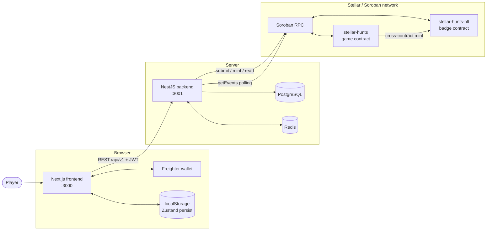
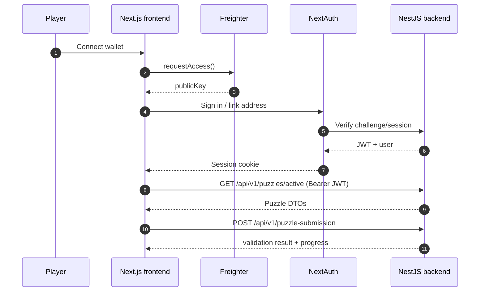
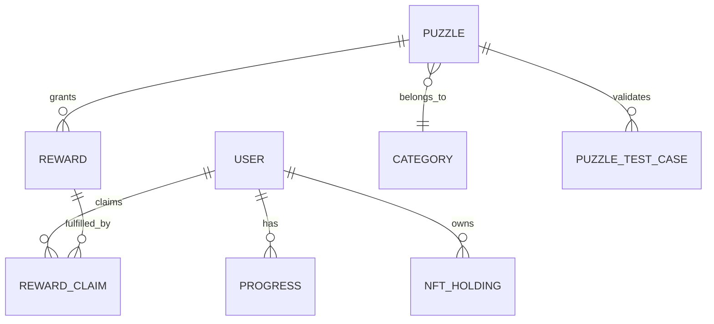
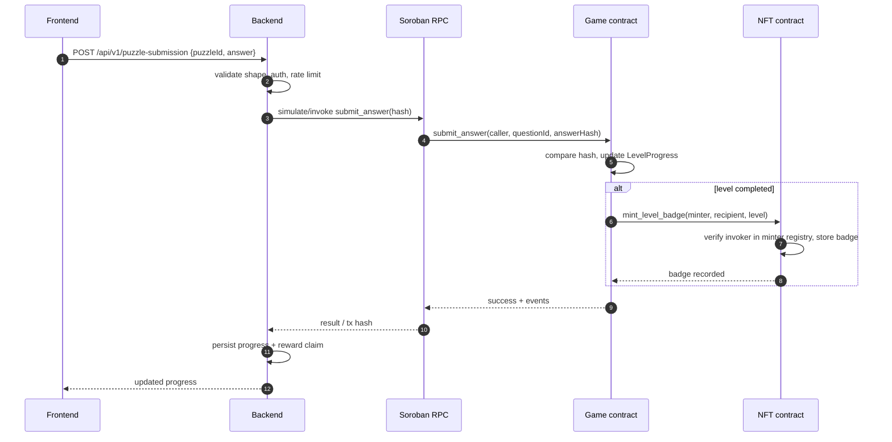
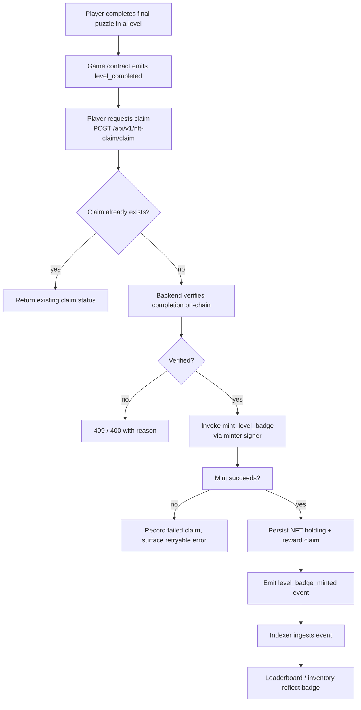
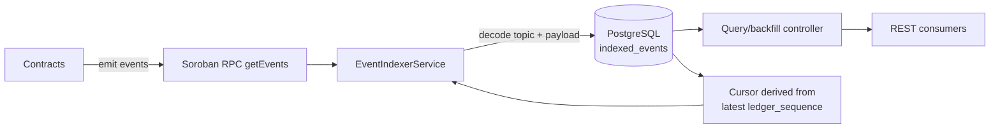
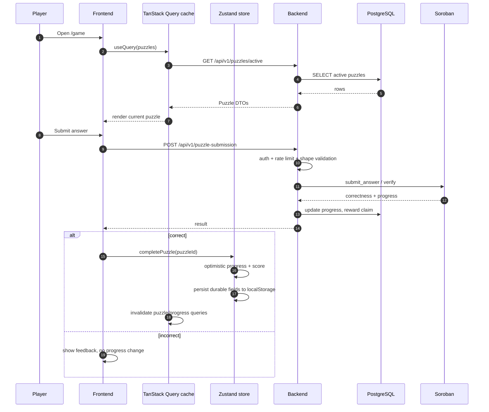

# StellarHunts System Design

This document describes the architecture of the StellarHunts platform: the
Next.js frontend, the NestJS backend, the Soroban contracts on Stellar, and the
flows that connect them. It complements `docs/architecture.md` with a
component-by-component view of responsibilities, trust boundaries, and data
flow, and it records the current implementation status of each integration.

**Audience:** contributors adding a feature that crosses more than one tier,
reviewers assessing isolation or failure behaviour, and operators who need to
know which component owns a piece of state.

**Related documents**

- `docs/architecture.md` — original system overview
- `docs/adr/0003-nestjs-modular-monolith.md` — backend deployment model
- `docs/adr/0006-soroban-event-indexing-strategy.md` — indexer decision
- `docs/adr/0007-redis-caching-layer.md` — cache / rate-limit decision
- `onchain/docs/contract-upgrade-and-rollback.md` — upgrade runbook
- `onchain/docs/storage-versioning.md` — on-chain storage compatibility rules
- `onchain/docs/event-schema.md` — canonical contract events
- `docs/api.md` — endpoint-level API reference

---

## 1. System context



Three trust domains are worth keeping separate:

| Domain | Owns | Does not own |
| ------ | ---- | ------------ |
| Browser | UI state, cached server state, wallet keys | Answers, scores, reward eligibility |
| Backend | Identity, puzzle content, progress records, reward orchestration | Cryptographic validation of answers; badge ownership |
| Soroban contracts | Answer hashes, level progress, badge ownership, upgrades | User accounts, browsing history, off-chain metadata |

The browser is untrusted. The backend is authoritative for off-chain records.
The contracts are authoritative for on-chain state (progress and badge
ownership), and the backend mirrors them rather than inventing them.

---

## 2. Monorepo layout and responsibilities

```
StellarHunts/
├── frontend/            Next.js App Router application (player UI)
├── backend/             NestJS API (modular monolith)
├── onchain/             Rust workspace: game, NFT, receiver, types crates
├── schemas/             Shared JSON Schemas (puzzle template, ...)
├── fixtures/            Example puzzle data used by validators/tests
├── scripts/             Repository maintenance and release tooling
├── docs/                Cross-cutting documentation and ADRs
└── stellar-extensions/  Isolated extension workspace (see §12)
```

| Component | Responsibility | Key entry points |
| --------- | -------------- | ---------------- |
| `frontend/` | Routing, rendering, wallet connection, optimistic UI, local progress persistence | `frontend/app/`, `frontend/store/`, `frontend/lib/api.js`, `frontend/services/` |
| `backend/` | Auth, puzzle CRUD, answer submission, progress, rewards, NFT claim orchestration, multiplayer sockets, caching, rate limiting | `backend/src/main.ts`, `backend/src/app.module.ts` |
| `onchain/` | Answer verification, level progression, badge minting, pause/upgrade, schema migration | `onchain/contracts/stellar_hunts/`, `onchain/contracts/stellar_hunts_nft/` |
| `schemas/` | Versioned content contracts shared by authors, CI, and migrations | `schemas/puzzle-template.schema.json` |
| `scripts/` | Validators, deploy helpers, release/changelog automation, benchmarks | `scripts/validate-puzzle-schema.js`, `scripts/deploy-contracts.sh` |

---

## 3. Runtime topology

| Service | Default | Notes |
| ------- | ------- | ----- |
| Frontend | `http://localhost:3000` | Next.js dev server; API origin from `NEXT_PUBLIC_API_URL` |
| Backend | `http://localhost:3001` | All routes under `/api/v1` except `/docs`, `/docs-json`, `/healthz`, `/readyz` |
| PostgreSQL | `localhost:5432` | Single primary database; TypeORM entities + migrations |
| Redis | `localhost:6379` | Cache, shared Socket.IO adapter when configured; optional locally |
| Soroban RPC | Testnet by default | `SOROBAN_RPC_URL`; contract IDs from environment |

`STELLAR_MODE` selects the on-chain adapter:

- `live` — the default; requires Soroban RPC URL and contract IDs, and fails
  startup if they are missing. Used for real testnet/mainnet integration.
- `mock` — local/CI mode. The backend returns synthetic on-chain successes and
  the event indexer does not poll. `mock` is rejected when
  `NODE_ENV=production`.

Keeping the default `live` is deliberate: a deployment that forgets its
credentials fails closed instead of handing out badges that were never minted.

---

## 4. Frontend

### 4.1 Rendering and routing

The frontend uses the Next.js App Router with server components for static
shells and client components for interactive game views. Routes relevant to the
system flow include `/`, `/game`, `/puzzles/roadmap`, `/invite-friends`,
`/ref/[referralId]`, and the admin puzzle-review/submission screens.

### 4.2 State layers

The frontend deliberately separates two kinds of state:

| Layer | Technology | Lifetime | Examples |
| ----- | ---------- | -------- | -------- |
| Server state | TanStack Query | Cache with invalidation, refetch on focus | puzzle lists, categories, leaderboard, inventory pages |
| Client/game state | Zustand + `persist` | Survives reload via `localStorage` | current difficulty/index, completed puzzles, score, NFT list in memory |
| Session | NextAuth + wallet adapter | Cookie/JWT session | authenticated user, linked Stellar address |

Zustand stores follow the conventions in `frontend/store/README.md`: unique
persist keys (`<store-name>:v<version>`), an explicit allow-list of persisted
fields, and synchronous legacy-key migrations before hydration. The game store
persists only durable progress (`completedPuzzles`, `completedDifficulties`,
`currentDifficulty`, `currentPuzzleIndex`, `score`) and intentionally does not
persist `user` or `nfts`, which are server-owned.

Mutations that affect progress are applied optimistically and rolled back to the
exact prior snapshot if the request fails, so the UI never shows progress the
server rejected.

### 4.3 Wallet and API interaction



`frontend/lib/api.js` centralises the base URL, the `/api/v1` prefix, response
error normalisation, timeouts, and bounded retries for idempotent requests.
Components should call the API through that client rather than `fetch` directly,
so auth headers and error shapes stay consistent.

---

## 5. Backend

### 5.1 Modular monolith

The backend is a NestJS modular monolith (ADR-0003): one deployable process,
with domain modules that own their controllers, services, DTOs, and entities.
Cross-domain calls use dependency injection, not HTTP or a queue. Horizontal
scaling runs additional replicas behind a load balancer.

Registered modules cover, among others:

- **Identity** — `AuthModule`, `UserModule`, `ApiKeyModule`, `SessionModule`
- **Puzzles** — `PuzzleModule`, `PuzzleSubmissionModule`,
  `PuzzleSolutionCheckerModule`, `PuzzleCategoryModule`,
  `PuzzleDependencyModule`, `PuzzleDraftModule`, `PuzzleVersioningModule`,
  `PuzzleTestCaseModule`
- **Progress and gamification** — `ProgressModule`, `StreakModule`,
  `MilestoneModule`, `AchievementModule`, `RewardsModule`,
  `RewardShopModule`, `DailyRewardModule`
- **On-chain integration** — `NFTClaimModule`, `TokenVerificationModule`,
  `WalletModule`
- **Platform** — `CacheModule`, `RateLimiterModule`, `OutboxModule`,
  `HealthModule`, `AnalyticsModule`

A module directory that is not listed in `backend/src/app.module.ts` is not
active at runtime. This matters for the event indexer (§9).

### 5.2 Persistence

PostgreSQL is the system of record for off-chain data, accessed through TypeORM.
Entity metadata is discovered via `autoLoadEntities` and each feature module's
`forFeature` registration; there is no hand-maintained global entity list.
Schema changes ship as migrations, and `synchronize` is a development-only
convenience.

Core relationships (simplified):



### 5.3 API conventions

- REST resources with a versioned prefix: `/api/v1/<resource>`.
- JWT bearer auth on protected routes; role guards on admin routes.
- DTO validation via `class-validator` with a global pipe configured with
  `whitelist` and `forbidNonWhitelisted` — unknown fields are rejected with 400
  rather than silently ignored.
- The OpenAPI document is served from `/docs-json`, with Swagger UI at `/docs`
  when enabled.
- Errors use conventional status codes; rate-limited responses include
  `Retry-After` and `X-RateLimit-*` headers.

### 5.4 Real-time

Multiplayer matchmaking uses Socket.IO. When Redis is configured, replicas share
a pub/sub adapter so a socket connected to one replica receives events emitted
by another. Without Redis the server falls back to an in-process adapter, which
is correct only for a single replica.

---

## 6. On-chain contracts

Two contracts implement the game's durable state.

### 6.1 `stellar-hunts` (game)

- Stores questions, answer hashes, hints, level progression, player progress,
  schema version, pause state, and the configured NFT contract address.
- Validates answers by comparing a submitted SHA-256 hash against the stored
  hash; plaintext answers never live on-chain.
- Tracks per-level completion and triggers badge minting through a cross-contract
  call to the NFT contract.
- Separates the `admin` and `upgrader` roles. `upgrade` requires the stored
  upgrader's authorization before `update_current_contract_wasm`.
- Supports `pause`/`unpause` as an emergency circuit breaker and
  `migrate_schema` for bounded, resumable storage migrations.

### 6.2 `stellar-hunts-nft` (badges)

- Owns per-level badge records keyed by `(Address, Levels)`.
- Maintains a minter registry; `mint_level_badge` verifies the invoker is an
  authorized minter (normally the game contract).
- Is pauseable and versioned independently of the game contract.

### 6.3 Storage and upgradeability

Storage keys are serialized enum variants, so renaming a variant creates a new
key and orphans the old data. The compatibility rules in
`onchain/docs/storage-versioning.md` apply:

- never reorder or renumber enum discriminants;
- bump `CURRENT_SCHEMA_VERSION` when a stored shape changes;
- migrate by reading the old key, writing the new key, verifying, then removing
  the old key (or keep a read fallback and migrate lazily);
- never reuse a key for a different meaning.

Upgrades preserve the contract address and storage. The runbook in
`onchain/docs/contract-upgrade-and-rollback.md` covers pause → identify known
good WASM → upgrade → verify state → unpause, with `contract_upgraded` events as
the audit trail.

---

## 7. Backend ↔ on-chain interaction

The backend never trusts the browser for on-chain facts. It reads contract state
through Soroban RPC and submits transactions from a configured signer.



Important properties of this boundary:

- **Mock vs live.** In `mock` mode the adapter returns deterministic synthetic
  success and no transaction is sent. This keeps unit tests and local
  development independent of network availability. Production deployments run
  `live`.
- **Idempotency.** Badge storage is keyed by `(Address, Levels)` and mint
  authorization is explicit, so retries cannot double-mint a level badge.
- **Ordering.** The backend records off-chain progress only after the on-chain
  result is known (or deliberately recorded as pending in a claim row), so a
  failed transaction does not leave a player with a reward the chain rejected.
- **Failure handling.** RPC errors are surfaced to the caller and logged; the
  chain remains authoritative and can be reconciled later.

---

## 8. NFT claim and reward distribution flow



Reward distribution has two layers:

1. **Immediate reward** — the off-chain progress/score update produced by a
   correct submission. This is fast and reversible by the backend.
2. **On-chain reward** — the level badge, minted only after the contract agrees
   the level is complete. This is the durable, transferable asset.

The two are intentionally not atomic. The backend's reward-claim table records
the state of the bridge between them (pending, confirmed, failed) so an operator
can reconcile a partially completed flow without re-minting.

---

## 9. Event indexing flow (on-chain → backend)

The indexer turns contract events into queryable rows so API reads do not depend
on RPC availability or RPC event retention.



Implementation (`backend/src/event-indexer/`):

- Polls every `EVENT_INDEXER_POLL_INTERVAL_MS` (default 6 s) for the configured
  contract IDs.
- Reads events page-by-page with `getEvents`, filtering by contract ID.
- Persists one row per event in `indexed_events` with `contractId`, primary
  `topic`, secondary `topics`, decoded `payload`, raw `rawXdr`,
  `ledgerSequence`, `txHash`, and `schemaVersion`.
- Skips duplicates using the natural key
  `(contractId, ledgerSequence, topic, txHash)` via an idempotent insert.
- Restores its cursor from the highest indexed ledger on startup, so a restart
  resumes instead of replaying history.
- Supports a bounded backfill over a ledger range (optionally `force`), which
  deletes and re-indexes that range.
- Disables polling entirely in `STELLAR_MODE=mock`, and exposes health/query
  endpoints through `EventIndexerController`.

**Current status:** `EventIndexerModule` is implemented but is *not* listed in
`backend/src/app.module.ts`. The module's own documentation says it must be
imported into `AppModule` to activate polling. Until that wiring lands, the
diagram above describes the intended production path, not a running poller in
the default deployment. The data model and ingestion rules are still the
contract that downstream consumers should code against.

Event payload rules come from `onchain/docs/event-schema.md`: topic symbols are
snake_case, positional payloads never reorder fields, and `level_badge_minted`
exists on both contracts with different arities (discriminate by contract ID or
payload length). Note that the on-chain `Levels` enum is documented with
explicit discriminants in the storage guide; indexers must not assume a
different ordering.

---

## 10. End-to-end puzzle-solving data flow



Ownership of each step:

| Step | Owner | Persistence |
| ---- | ----- | ----------- |
| Puzzle content | Backend (`puzzles` table) + published fixtures | PostgreSQL, optionally versioned |
| Answer grading | Contract (hash comparison); backend orchestrates | On-chain `LevelProgress` |
| Progress mirror | Backend (`progress` module) | PostgreSQL |
| Client game state | Zustand | `localStorage` (`game-store:v1`) |
| Reward claim | Backend (`reward`, `nft-claim` modules) | PostgreSQL claim rows |
| Badge ownership | NFT contract | On-chain `Badge(Address, Levels)` |

The frontend store also contains legacy optimistic calls to `/game/update`,
`/game/reset`, and `/game/difficulty-config`. Those paths have no matching
backend controller in the current tree; the server-of-record path for solving is
`POST /api/v1/puzzle-submission`, and local reset/logout is handled in the store.
Any feature that needs server-side reset should call the progress module rather
than reintroducing the legacy path.

---

## 11. Caching layer

Caching is a best-effort acceleration layer in front of PostgreSQL, implemented
by `backend/src/cache/`:

- **Backend store:** Redis via `ioredis`, namespaced by `CACHE_NAMESPACE`
  (default `stellarhunts`).
- **Pattern:** `getOrSet(key, ttlSeconds, loader)` with per-key TTL plus random
  jitter to avoid synchronized expirations.
- **Single-flight:** concurrent requests for the same key share one in-flight
  loader promise, preventing cache stampedes on read-heavy endpoints.
- **Invalidation:** versioned invalidation (`invalidate` bumps a version and
  evicts affected keys) plus explicit per-key invalidation. Feature services own
  the invalidation calls for their data.
- **Failure semantics:** Redis read failure falls through to the loader; loader
  failure is propagated and not cached; write failure logs and still returns
  fresh data. An unavailable Redis degrades to direct database reads rather
  than failing requests.
- **What is cached:** read-heavy, low-churn responses such as leaderboards,
  category lists, and analytics aggregates. Player-authoritative writes are
  never served from cache.

Cache invalidation is manual by design (ADR-0007). A missed invalidation is a
stale-read bug, not a data-loss bug, because PostgreSQL remains the source of
truth. The frontend's TanStack Query cache is a separate layer with its own
query-key invalidation; it does not share keys with Redis.

---

## 12. Rate limiting layer

Rate limiting is implemented by `backend/src/rate-limiter/`:

- `@RateLimit({ ttl, limit })` marks a handler; `RateLimitGuard` enforces it.
- Keys are scoped per handler and per identity: custom key generator, then
  authenticated user id, then client IP (`X-Forwarded-For` aware).
- The window is a fixed window. Once the limit is reached the key is locked out
  until the window expires.
- Rejections return HTTP 429 with `Retry-After`, `X-RateLimit-Limit`,
  `X-RateLimit-Remaining: 0`, and `X-RateLimit-Reset`.
- The current store is an in-process `Map` with a periodic eviction timer. That
  is sufficient for a single replica but does not coordinate across replicas;
  ADR-0007's Redis-backed distributed throttler is the intended evolution. Do
  not assume cross-replica limits today.
- A representative policy is `POST /api/v1/puzzle-submission` at 5 requests per
  60 seconds per user/IP.

Rate limiting is distinct from anti-cheat. It bounds request volume; it does not
decide whether an answer is correct (the contract does) and it does not prevent
a determined player from solving puzzles slowly.

---

## 13. Security boundaries

| Boundary | Control |
| -------- | ------- |
| Browser → API | JWT bearer tokens, DTO whitelist validation, CORS allow-list, rate limits |
| API → database | Parameterised TypeORM queries, migrations, least-privilege DB user |
| API → Soroban | Signing keys from environment/secret manager, `live` mode fails closed without config |
| Contract entrypoints | `require_auth` on player and admin/upgrader roles, pause switch, role separation |
| Cross-contract calls | Invocation-scoped authorization, minter registry on the NFT contract |
| Answer confidentiality | Only SHA-256 hashes stored on-chain |
| Upgrades | Dedicated upgrader role + `contract_upgraded` event |
| Storage evolution | Versioned keys, explicit schema version, documented migration rules |
| Secrets | Never committed; gitleaks and private-key hooks run pre-commit |

The backend signs transactions, so its signer is a high-value key. It should be
a dedicated minter/operator identity with only the permissions the flow needs,
never the contract admin or upgrader key.

---

## 14. Observability and operations

- **Health:** `/healthz` (liveness) and `/readyz` (readiness) are excluded from
  the API prefix; the health module reports PostgreSQL, Redis, and Soroban RPC
  status separately. Redis degradation is reported as degraded, not down.
- **Tracing:** a global request-trace interceptor assigns/propagates
  `X-Trace-Id` and emits structured request/response logs. Sampling is
  controlled by `LOG_SAMPLE_RATE`.
- **Indexer health:** `EventIndexerService.getHealthStatus()` reports the last
  indexed ledger, last poll time, pending backfills, and schema version; exposed
  through the module's controller when the module is mounted.
- **Contract operations:** pause/unpause, upgrade, and schema migration follow
  the runbooks in `onchain/docs/`. Every mutation emits an event.
- **Known operational gaps:** the indexer is not mounted by default (§9); the
  rate limiter is per-process (§12); Redis is optional locally and required for
  multi-replica sockets and coordinated limits.

---

## 15. Failure modes

| Failure | Effect | Mitigation |
| ------- | ------ | ---------- |
| PostgreSQL unavailable | API cannot read/write authoritative data | Readiness fails; no silent writes |
| Redis unavailable | Cache misses, socket fan-out limited to one replica | Graceful degradation; requests fall through to DB |
| Soroban RPC unavailable | `live` submissions/claims fail; reads can use indexed data | Bounded retries, surfaced errors, reconciliation via backfill |
| Indexer lag or downtime | Leaderboard/inventory mirrors are stale | Cursor-based resume + bounded backfill |
| Bad upgrade | Broken behaviour or state interpretation | Pause → rollback WASM → verify state → unpause |
| Failed mint after correct answer | Player sees pending/failed claim | Claim row records state; retry is idempotent per `(address, level)` |
| Client crash before persistence | Unsaved local progress lost | Server progress is authoritative; local store is a cache |
| Multiple backend replicas | Rate limits/socket delivery not coordinated | Configure Redis; treat per-process limit as a known limitation |

---

## 16. Extension workspace

`stellar-extensions/` is an isolated area for new capabilities that are not yet
part of the core deployment: frontend components/hooks, backend modules,
contracts, scripts, tests, documentation, and puzzle sets. Each extension keeps
its own README/tests and must not modify `frontend/`, `backend/`, `onchain/`,
`docs/`, or `scripts/`. The extension code is reviewed and promoted into the
core tree deliberately, so its presence in this document does not imply it is
wired into the runtime paths above.

---

## 17. Change checklist

When changing a flow that crosses tiers, confirm:

1. Who owns the state after the change (browser, backend, or contract)?
2. Is the new contract entrypoint authorized for the right address and role?
3. Does a failed cross-tier step leave a resumable, idempotent record?
4. Are persisted Zustand fields still on the allow-list, and is the persist key
   unchanged or migrated?
5. Does the change emit an event that the event schema documents?
6. Are cache keys invalidated by the write path that changes them?
7. Do new endpoints declare a rate-limit policy and DTO validation?
8. Are storage keys/shapes backward compatible, or is a schema bump and
   migration included?
9. Does the change stay inside the tier or extension folder it belongs to?
